# Little Sprouts

Early-learning games for young children. A learner picks a picture, hears the question, and answers. Grown-ups can set the level, the sight words, and how the child plays.

A new browser asks a grown-up for the child’s name, math band, and garden buddy before play. Words and math facts stay empty, so games use the included list for that grade. Each learner keeps a name, a garden buddy, a math band, and stars on this browser.

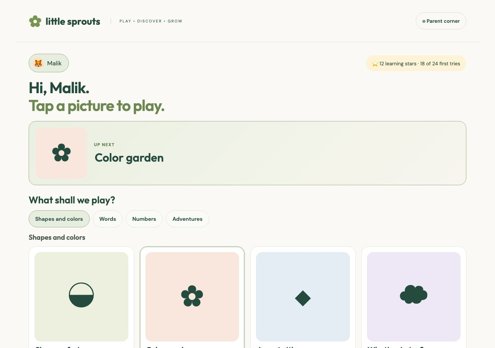

## Layout

- `games/` — per-game play modules
- `tests/` — Node tests (`node --test tests`)
- `logic/crayon-pages.mjs` — Color by number outlines
- `lib/home-ui.mjs` / `lib/parent-ui.mjs` — home and Parent corner HTML helpers
- `sidecars/`, `server/`, `voice/`, `tools/` — sidecars, local server, baked speech, build helpers

## How to run

From this folder:

```
node server/serve.mjs
```

Open http://localhost:8000. There is no build step. From that address the browser can install Little Sprouts, and the pages already opened keep working if the network drops. This server also opens the friend room for Paint Sphere and Garden gulp. If the site is already running from `python3 -m http.server`, start `node server/paint-link.mjs` beside it. Play with a friend uses that room.

## Play with a friend, with or without internet

Paint Sphere and Garden gulp share one friend room (`lib/friend-link.mjs`). Both games' `link.js` hand it their room socket, so the games don't change.

- **Internet up:** the relay gives out the room code and link as before. Once both players are in, the two browsers open a direct WebRTC connection, and game messages travel over it. On the same Wi-Fi they never leave the house. If the direct connection can't open, messages keep going through the relay. If the internet drops mid-game, the direct connection carries on.
- **Internet down, same Wi-Fi:** no relay answers, so a card asks **Start a room** or **Join a friend**. The host's computer chirps about four seconds of sound carrying its connection details (ggwave), and the friend's computer hears it and chirps back. The same details also show as a QR code for a tablet or phone to scan. Then the direct connection opens. Each device needs to have opened Little Sprouts online once, so the app is cached.
- **Host online, friend offline:** the host can tap **Friend has no internet? Join on this Wi-Fi** and use the same sound handshake.

Joining by sound needs the microphone once, and it works best with the computers close together and the sound up. Guest Wi-Fi networks that keep devices apart (client isolation) block the direct connection. `lib/friend-wire.mjs` packs a WebRTC offer or answer into about 75 bytes; `tests/friend-link.test.mjs` covers it and a full chirp round trip.

## How a round works

Home shows **Up next**, then **What shall we play?** with shelves for shapes and colors, words, numbers, and adventures. **How we play** opens Tap, Move, Hunt, or Reach:

- **Tap** — the child answers on the screen.
- **Move** — the game calls out a movement, and a grown-up taps when the child lands on the right floor card. Floor cards can be printed from Parent corner.
- **Hunt** — the child finds a real thing that matches, and a grown-up confirms.
- **Reach** — after a grown-up allows it, the camera watches the child’s hands. Holding a hand on an answer picks it. Video is never recorded or uploaded.

The first visit starts with a small addition problem, then a short setup for the child’s name, math band, and garden buddy. Parent corner is the gear at the top, behind that same check. Inside, you can rename learners, set the math band, set each game’s level, pin Up next, and type sight words. Leave the word list blank and the games use the included list for that grade. It is a grown-up check, not a lock.

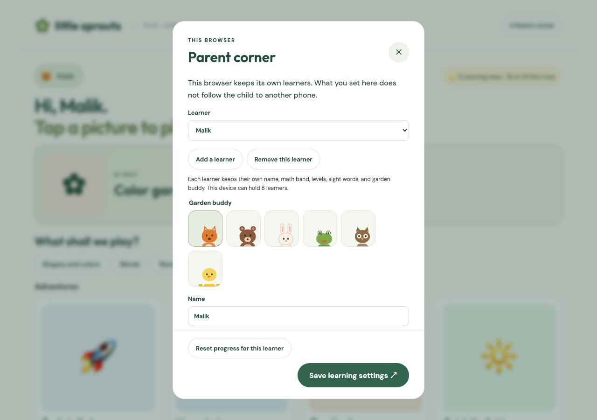

Most rounds are 5, 10, or 15 questions. A right answer on the first try earns a learning star. Arcade games such as Gas race, Dirt ride, and Sky flight keep going on their own clocks.

## Read-aloud

Prompts are spoken by Kokoro, a voice model that runs in this browser. It downloads once, about 90 MB from jsDelivr and Hugging Face, the first time read-aloud is used. Every line it says is saved in the browser and replays at once later. While the model is still downloading, a line it has not said before is read by the browser’s own voice. Once the model is ready, a new line waits for Kokoro. On a recent laptop that takes about as long as the line itself. If the model cannot load, the browser’s voice reads aloud and the app tries again later.

In Parent corner, **Hear this voice** shows download progress, then plays a sample. **Give game hosts their own voices** lets racing and arcade games use a second voice. Reading and math always use the voice the grown-up picked. The app itself still needs the server to load. Saved lines keep playing if the model cannot download. How it works, and the checks to run by hand: [docs/voice.md](docs/voice.md).

## The shelf

Every game is a card on a home shelf. Shapes, colors, words, and counting sit beside the adventure games. **Star garden** shows each learner’s sprout and stars.

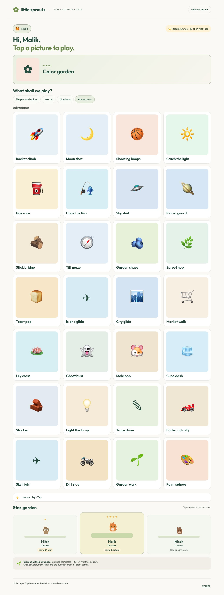

Shape safari in motion:

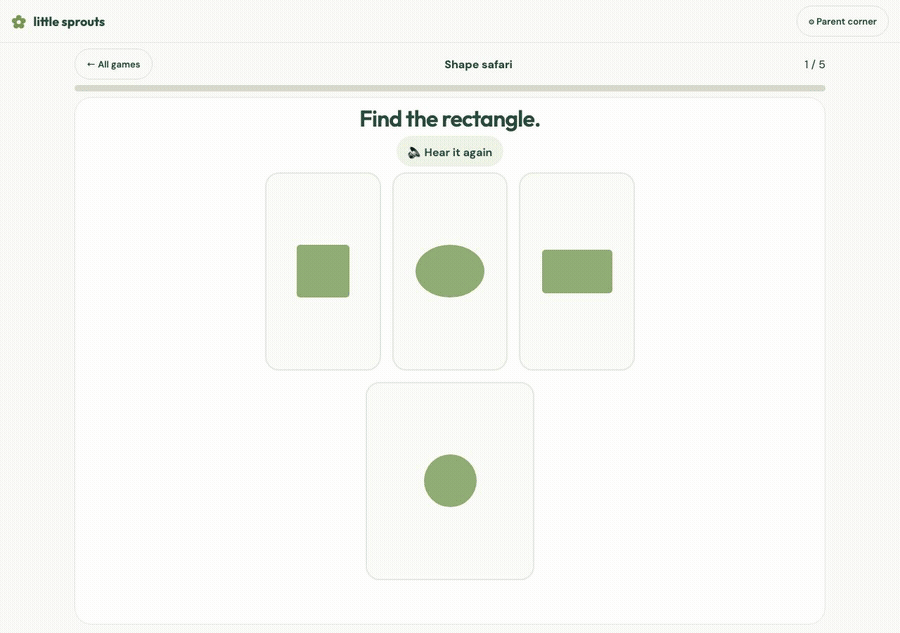

<p>
  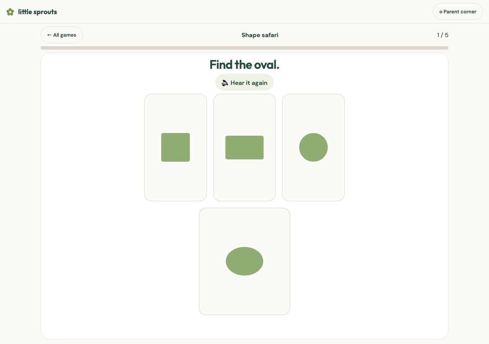
  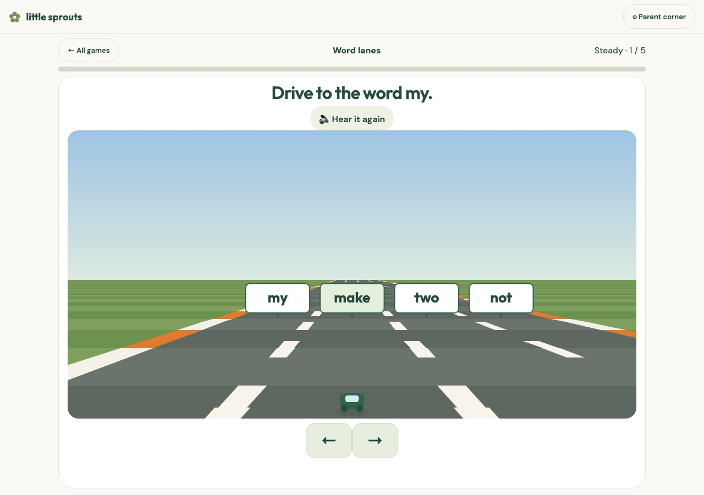
</p>
<p>
  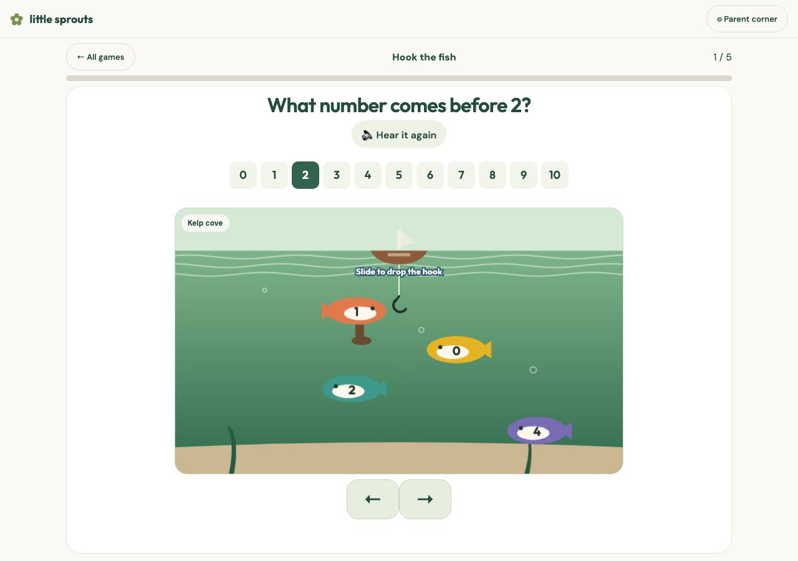
  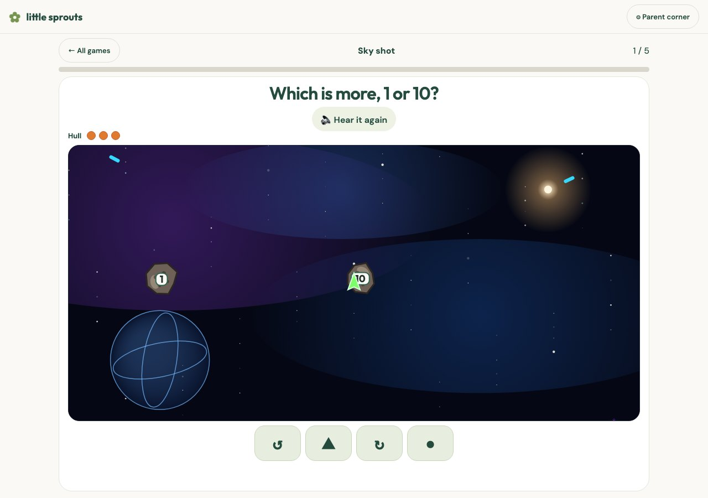
</p>
<p>
  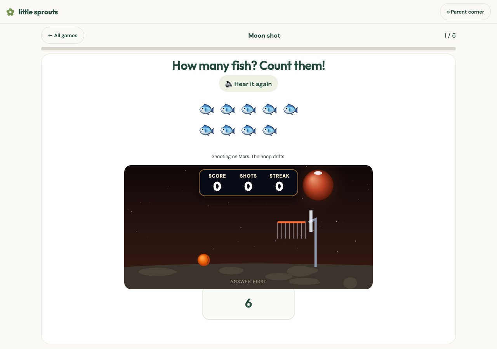
  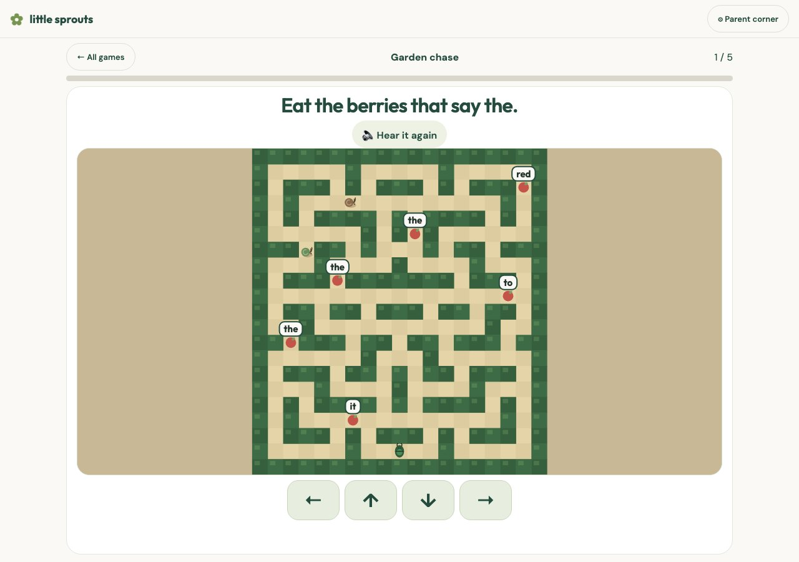
</p>
<p>
  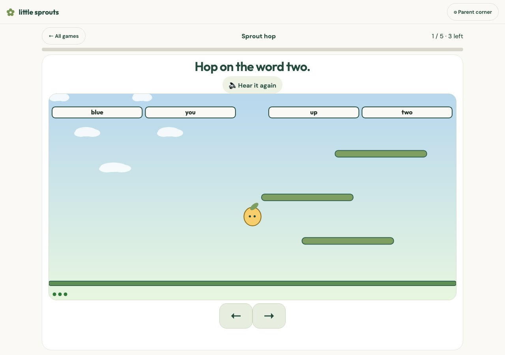
  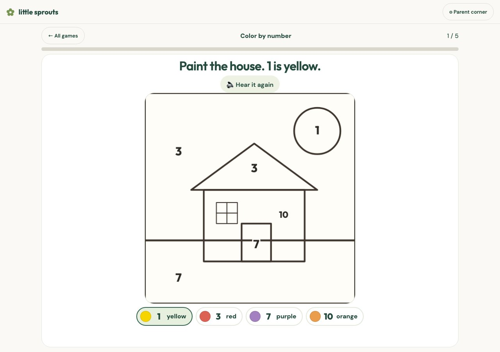
</p>
<p>
  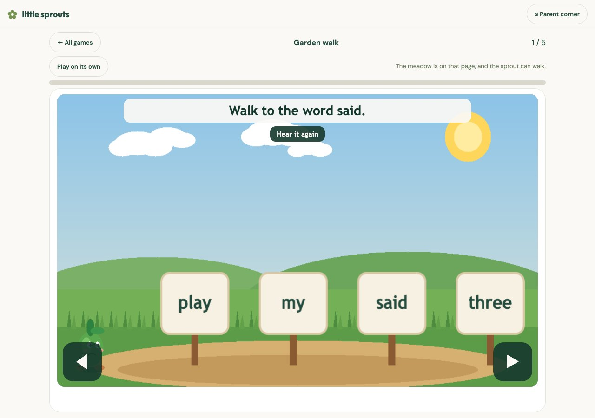
  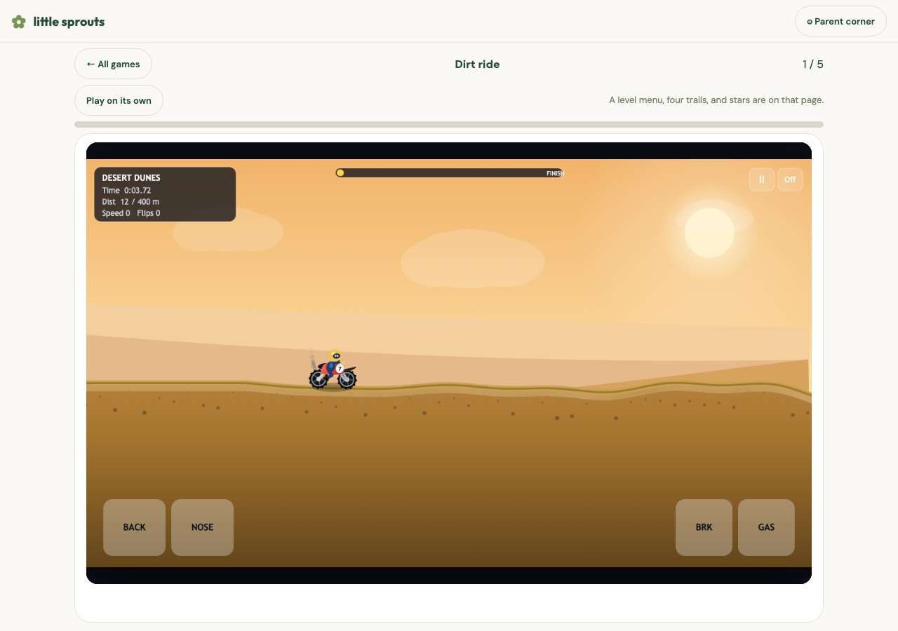
</p>
<p>
  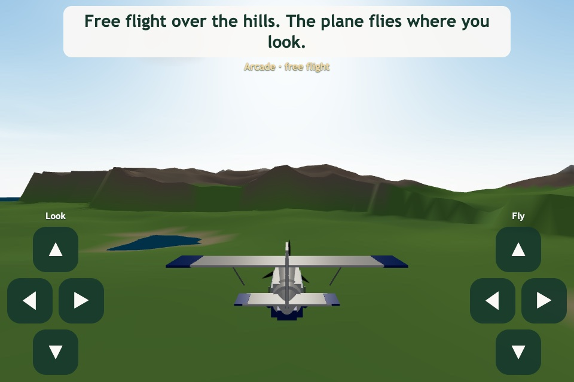
  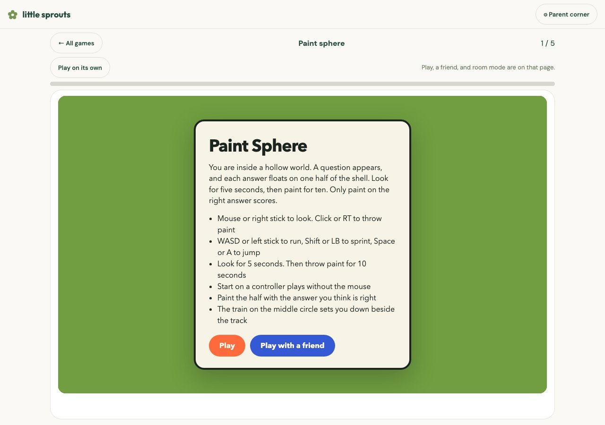
</p>

## Credits

Most of the pictures, questions, and games are Little Sprouts’ own. These creators made work the app uses, or ideas it follows. The same list is on the site under **Credits**.

- [Jake Gordon — javascript-racer](https://github.com/jakesgordon/javascript-racer) (MIT). Word lanes and Gas race use his road drawing.
- [cnrasili — Hooked](https://github.com/cnrasili/Hooked). Hook the fish follows that cast-and-steer idea. The pictures and sounds here are new.
- [Karim Maaloul (Yakudoo) — running CodePen](https://codepen.io/Yakudoo/pen/YGxYej). Garden dash follows that look and feel: the side view of a runner on a little turning planet, the misty trees with cube fruit, the jump, the chaser that closes in after each bump, and the sit-up munch when it catches you. The buddy, caterpillar, garden things, answer boards, and code are Little Sprouts’ own.
- [Megafry — Toast Catcher](https://codepen.io/Megafry/pen/yyyZyYw). Toast pop uses that arc and the lives.
- [Jamie Coulter — The Mine](https://codepen.io/jcoulterdesign/pen/NOMeEb). Market walk uses that aisle engine: one step per arrow, the shop follows, and you pick up what is in the spot you are standing in. The market and the shopper are drawn here.
- [deeptoaster — Pure CSS Whac-A-Mole](https://codepen.io/deeptoaster/pen/eYdEPzj). Mole pop follows that peek from the holes. A tap on empty dirt misses. The moles and the questions are drawn here. MIT.
- [Jason Leisure — Red vs Blue](https://codepen.io/Jason-Leisure/pen/zYeLvRd). Cube dash uses that blue path, the red cubes that rush in, and the lives. The questions and the on-screen buttons are Little Sprouts’ own.
- [Jhey — Ghost bustin'](https://codepen.io/jh3y/pen/wYzWxz). Ghost bust follows that bob, the 15 second clock, and the colored-ghost score.
- [Jerry Low — Pure CSS Stacker](https://codepen.io/jerrylow/pen/WMNdzr). Stacker follows that sliding row. Blocks that miss the row below fall away. The blocks and the questions are drawn here.
- [William Malone — canvas drawing](https://www.williammalone.com/articles/create-html5-canvas-javascript-drawing-app/). Color by number follows his brush. The pictures are new.
- [JS Planet Defense](https://freefrontend.com/javascript-games/#2025-11-02-js-planet-defense-game-l) on FreeFrontend. Planet guard follows that aim. It is drawn here.
- [Glass Physics 3D Jigsaw](https://freefrontend.com/javascript-games/#2026-01-01-glass-physics-3d-jigsaw-puzzle-l) on FreeFrontend. Shape puzzle follows that glass-piece idea.
- [Animated emoji memory game](https://freefrontend.com/javascript-games/#2025-09-09-emoji-memory-match-l) on FreeFrontend. Pair match follows that flip. The cards are new.
- [Zultan — low-poly plane over a turning world](https://codepen.io/Zultan/pen/mwGZBP). Island glide follows that look and feel: the turning green world, orbiting clouds, low sun, and a plane that eases after the pointer. It is rebuilt here for current Three.js; the buddy pilot, gems, and questions are drawn here.
- [TurdleTips — Paper City Glider](https://codepen.io/TurdleTips/pen/01a00355-5252-7ba3-b92d-90c79c3e616a). City glide follows that paper plane through downtown blocks. The plane, the rings, and the questions are drawn here.
- [Jens Broecher — Airplane pulling a banner](https://codepen.io/jensbroecher/pen/wvZQdEa). Sky flight’s bush plane follows that blue-and-white utility look. The plane is rebuilt here; no CodePen bitmap is shipped.
- [Ricardo Cabello and the Three.js authors](https://github.com/mrdoob/three.js) (MIT). Sky flight’s quiz gates and bush plane, Paint sphere, Garden gulp, Targets, Cube dash, City glide, and Island glide draw with Three.js. The plane and gates are Little Sprouts’ own.
- Hole games such as Hole.io, Donut County, and browser takes like Gulp City. Garden gulp follows that swallow-and-grow idea. The garden, holes, and friend-room play are drawn here.
- [SimonDev — Quick_FPS1](https://github.com/simondevyoutube/Quick_FPS1) (MIT). Targets’ Walk mode follows that first-person paintball walk. The plaza, boards, and paint launcher are drawn here; no enemies or health came along.
- [Quaternius — Ultimate Platformer Pack](https://quaternius.com) (CC0). The street lights, crates, fence, tanks, pipes, and gears in the Walk plaza, from the copy shipped with Quick_FPS1.
- [hexgrad — Kokoro](https://github.com/hexgrad/kokoro) (Apache 2.0). Spoken prompts use Kokoro-82M through [onnx-community’s ONNX build](https://huggingface.co/onnx-community/Kokoro-82M-v1.0-ONNX). If it cannot load, the browser’s own voice speaks.
- [Google — MediaPipe Pose](https://ai.google.dev/edge/mediapipe/solutions/vision/pose_landmarker). Reach play uses it to find hands. Video stays on the device.
- [Cassie Evans — CSS / SVG Blobby Background](https://codepen.io/cassie-codes/pen/zWJxXj). Merge jar uses that gooey blur, so matching circles melt together when they touch. The jar, the tokens, and the questions are drawn here.
- [Pedro Tavares — Shooting Hoops](https://codepen.io/dipscom/pen/amxYvB). Shooting hoops follows that flick: drag the ball, let go, and it arcs at the rim. Three hoops show the answers. The gym, the ball, and the questions are drawn here.
- [Amit Sheen — Catch That Light!](https://codepen.io/amit_sheen/pen/dyQGQLr). Catch the light follows that ring and the tap when the moving light meets the green bulb. Rush gets faster after every catch. The questions are Little Sprouts’ own.
- [Outfit](https://fonts.google.com/specimen/Outfit) by Rodrigo Fuenzalida and [DM Sans](https://fonts.google.com/specimen/DM+Sans) by Colophon Foundry, from Google Fonts.

## Notes

Settings and stars stay in this browser. They do not sync to another device. Clearing site data clears them. `node --test tests` checks the learning rules, Reach, read-aloud, the controller, and tilt.
