# Little Sprouts

Early-learning games for young children. A learner picks a picture, hears the question, and answers. Grown-ups can set the level, the sight words, and how the child plays.

Three learners start on this device: Malik in preschool, Micah in kindergarten, and Mitch in 4th grade. Each one keeps a name, a garden buddy, a math band, and stars. Progress stays in this browser.

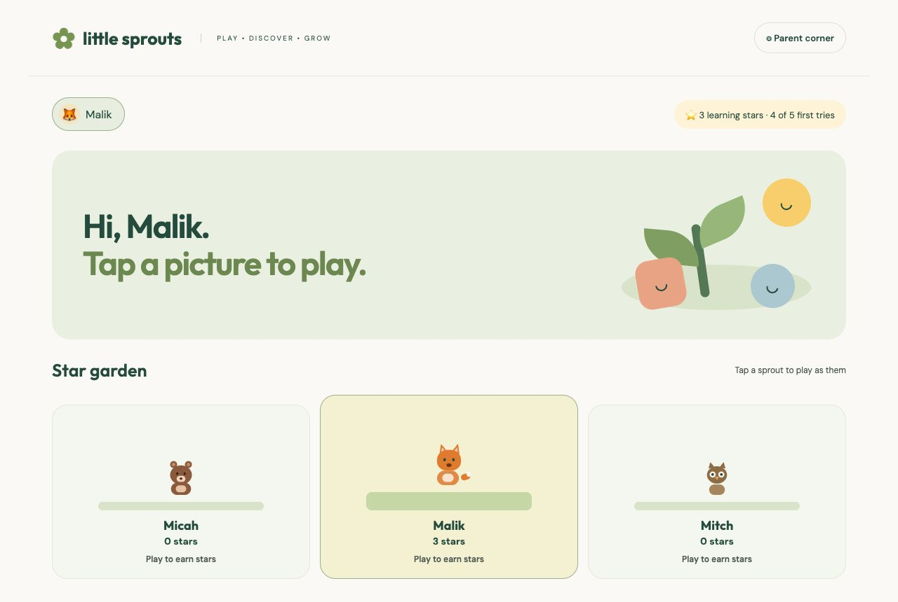

## How to run

From this folder:

```
python3 -m http.server 8000
```

Open http://localhost:8000. There is no build step.

## How a round works

On the home screen, under **How are we playing?**:

- **Tap** — the child answers on the screen.
- **Move** — the game calls out a movement, and a grown-up taps when the child lands on the right floor card. Floor cards can be printed from Parent corner.
- **Hunt** — the child finds a real thing that matches, and a grown-up confirms.
- **Reach** — after a grown-up allows it, the camera watches the child’s hands. Holding a hand on an answer picks it. Video is never recorded or uploaded.

Parent corner is the gear at the top. The grown-up check is a small addition problem. Inside, you can rename learners, set the math band, set each game’s level, change the sight words, and turn read-aloud on or off. It is a grown-up check, not a lock.

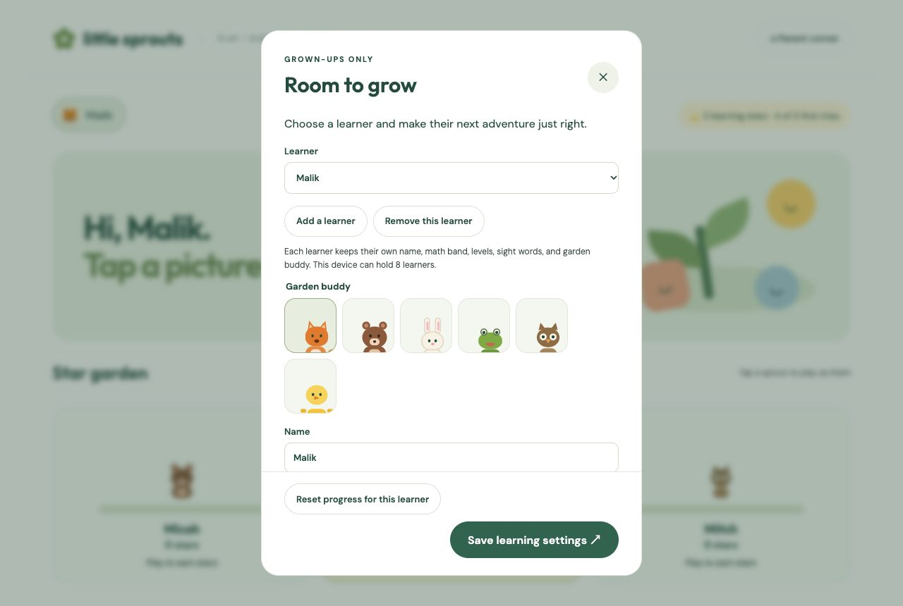

Most rounds are 5, 10, or 15 questions. A right answer on the first try earns a learning star. Arcade games such as Gas race, Dirt ride, and Sky flight keep going on their own clocks.

## The shelf

Every game is a card on the home screen. Shapes, colors, words, and counting sit beside the arcade games.

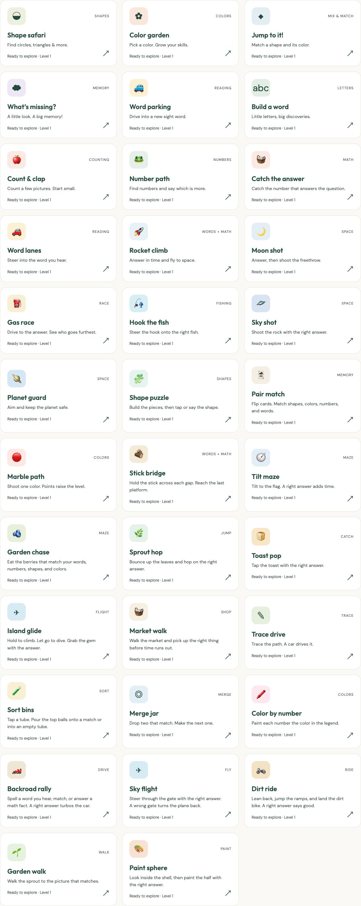

Backroad rally’s stage files are not in this repository, so that card stays hidden unless those files are added beside the others.

<p>
  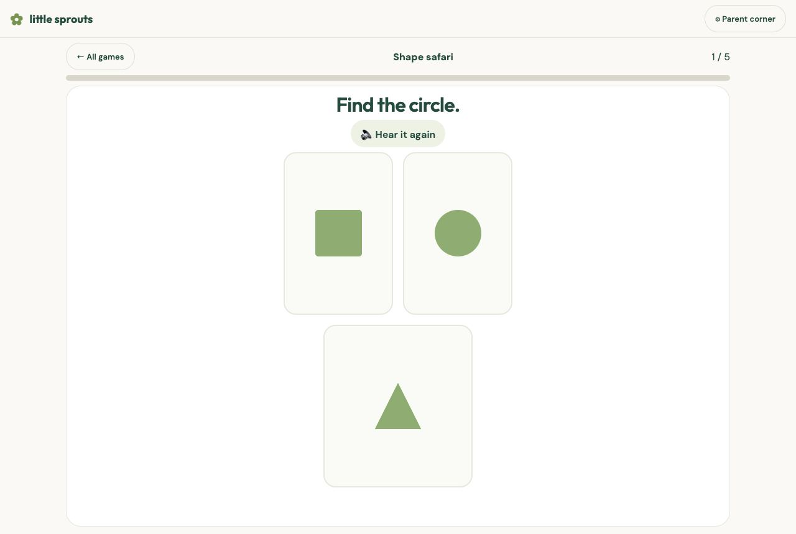
  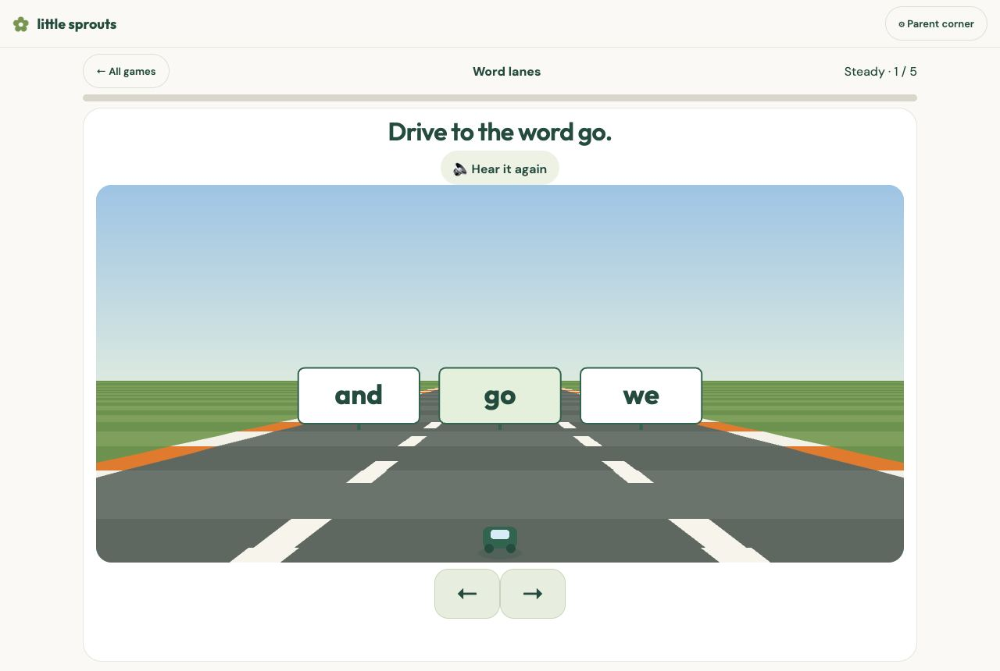
</p>
<p>
  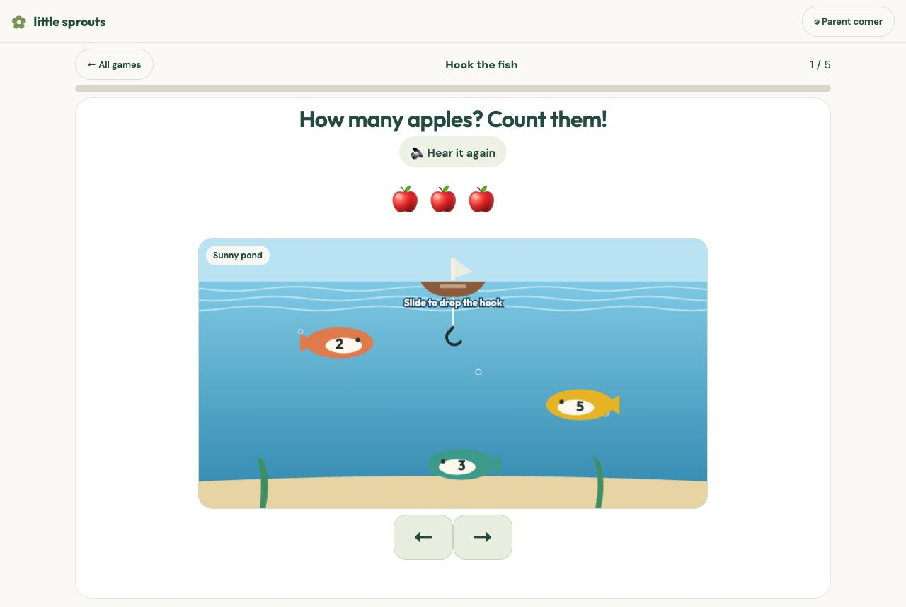
  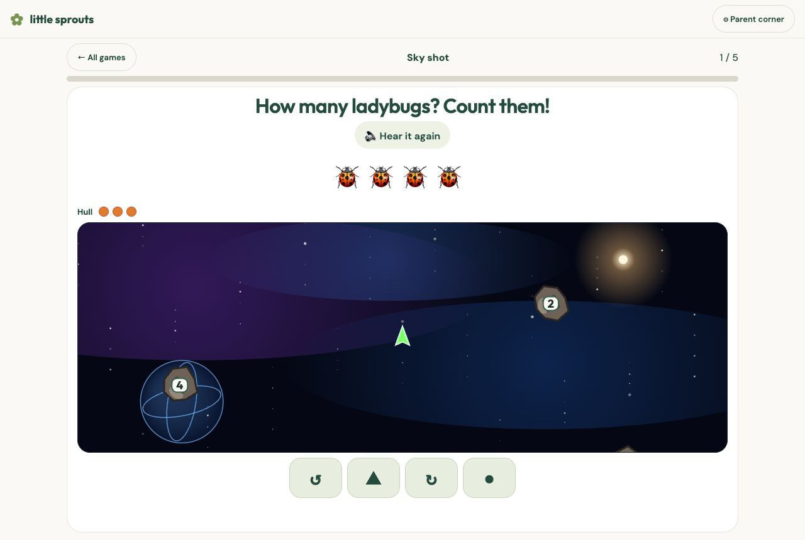
</p>
<p>
  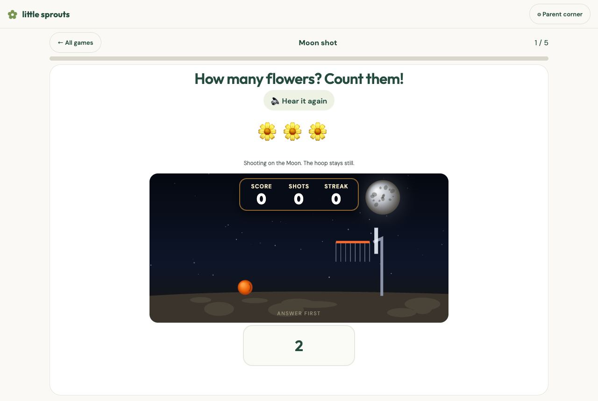
  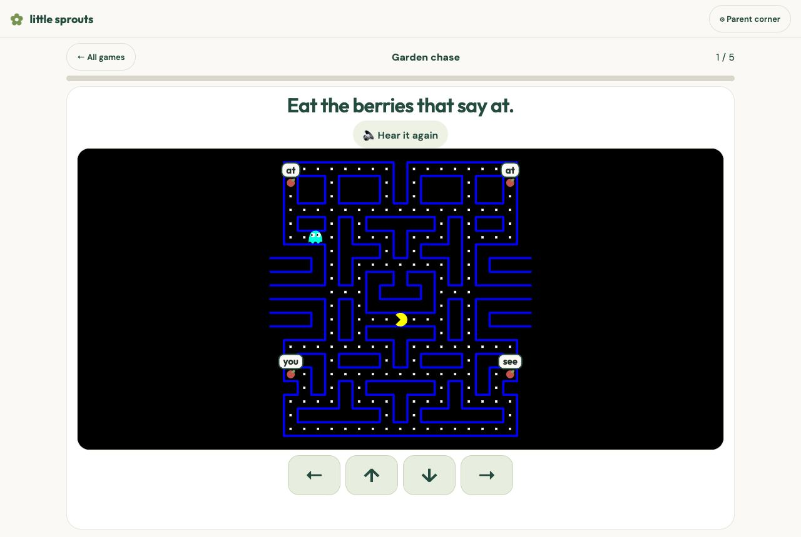
</p>
<p>
  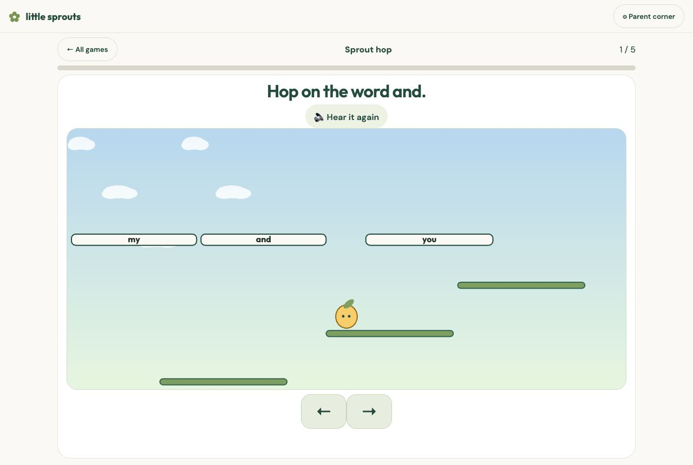
  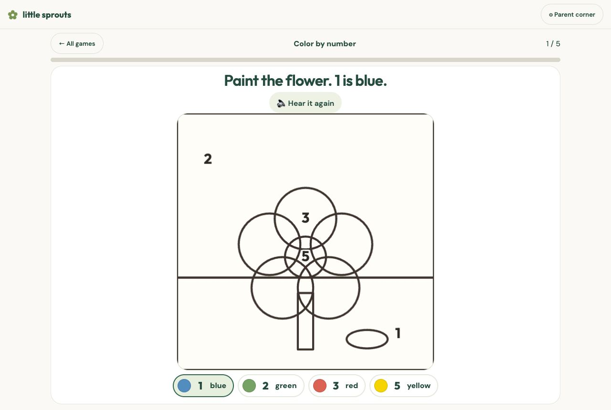
</p>
<p>
  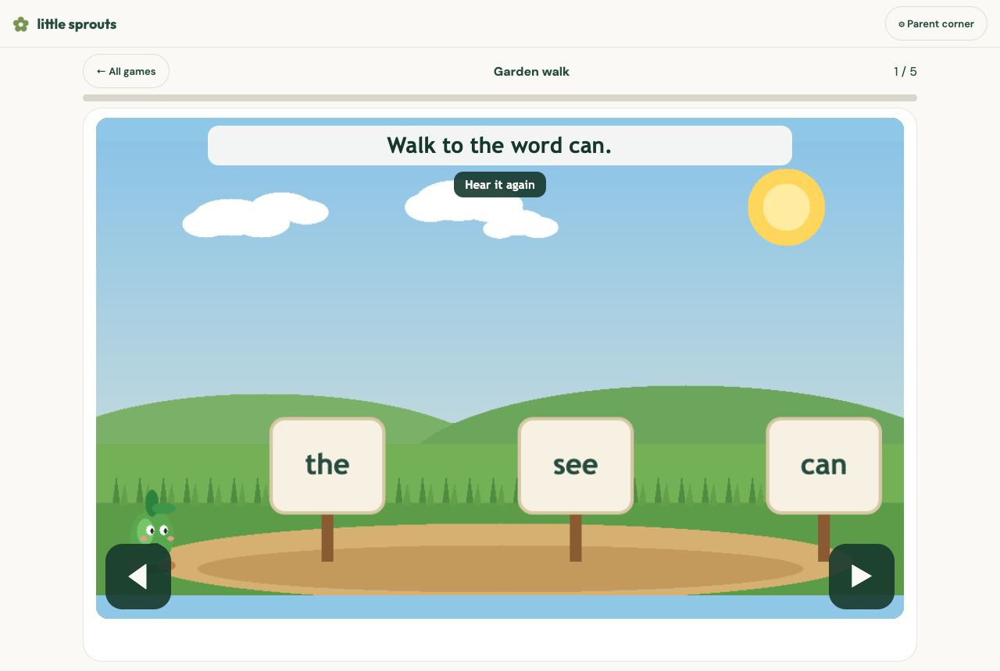
  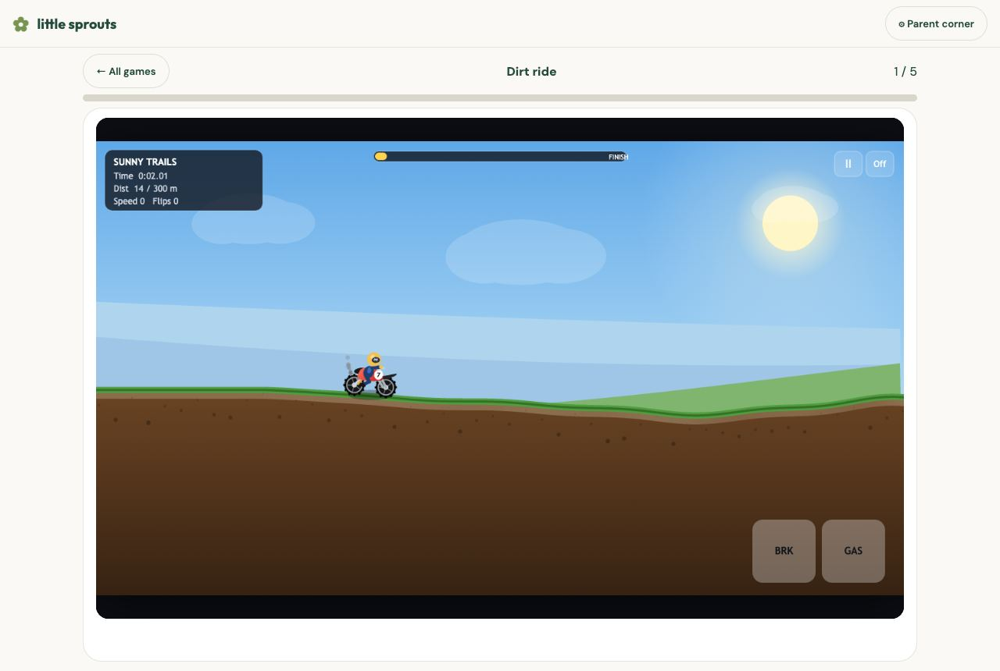
</p>
<p>
  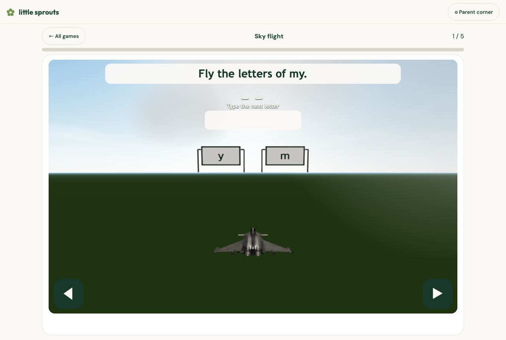
  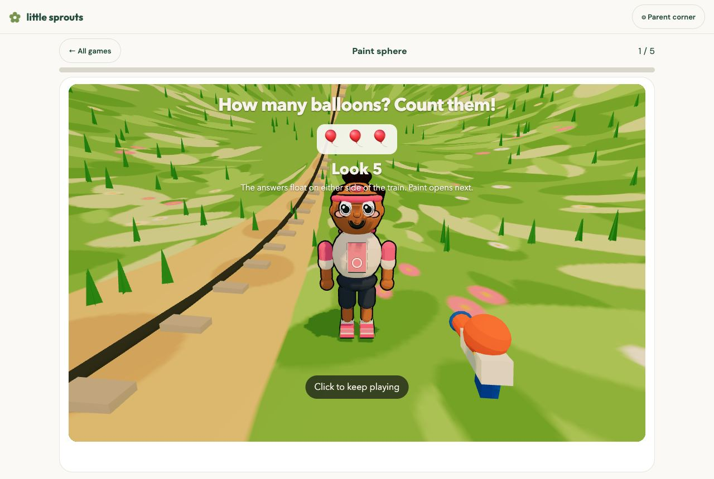
</p>

## Credits

Most of the pictures, questions, and games are Little Sprouts’ own. These creators made work the app uses, or ideas it follows. The same list is on the site under **Credits**.

- [Jake Gordon — javascript-racer](https://github.com/jakesgordon/javascript-racer) (MIT). Word lanes and Gas race use his road drawing.
- [cnrasili — Hooked](https://github.com/cnrasili/Hooked). Hook the fish follows that cast-and-steer idea. The pictures and sounds here are new.
- [hellokatili — HTML5 Pacman](https://codepen.io/hellokatili/pen/xwKRmo). Garden chase uses that maze and the way it moves. The berries are new.
- [FRADAR — Doodle Jump](https://codepen.io/FRADAR/pen/XWMzvaM). Sprout hop uses that hop. The sprout and leaves are drawn here.
- [Megafry — Toast Catcher](https://codepen.io/Megafry/pen/yyyZyYw). Toast pop uses that arc and the lives.
- [William Malone — canvas drawing](https://www.williammalone.com/articles/create-html5-canvas-javascript-drawing-app/). Color by number follows his brush. The pictures are new.
- [William Malone — BlocksJS](https://www.williammalone.com/) 0.5.32 (MIT). Garden walk uses it for the canvas and the walk.
- [JS Planet Defense](https://freefrontend.com/javascript-games/#2025-11-02-js-planet-defense-game-l) on FreeFrontend. Planet guard follows that aim. It is drawn here.
- [Glass Physics 3D Jigsaw](https://freefrontend.com/javascript-games/#2026-01-01-glass-physics-3d-jigsaw-puzzle-l) on FreeFrontend. Shape puzzle follows that glass-piece idea.
- [Animated emoji memory game](https://freefrontend.com/javascript-games/#2025-09-09-emoji-memory-match-l) on FreeFrontend. Pair match follows that flip. The cards are new.
- [jeanjerome — OpenSkyFlight](https://github.com/jeanjerome/OpenSkyFlight). Sky flight uses that chase camera and aircraft loading.
- [pjedvaj — Dassault Rafale B](https://www.cgtrader.com/free-3d-models/aircraft/military-aircraft/dassault-rafale-b-bdc1590e-5936-4912-ba44-79f5c2e09f07). The plane model, made in Cheetah3D and shared royalty-free on CGTrader.
- [Ricardo Cabello and the Three.js authors](https://github.com/mrdoob/three.js) (MIT). Sky flight and Paint sphere draw with Three.js.
- [hexgrad — Kokoro](https://github.com/hexgrad/kokoro) (Apache 2.0). Spoken prompts use Kokoro-82M through [onnx-community’s ONNX build](https://huggingface.co/onnx-community/Kokoro-82M-v1.0-ONNX). If it cannot load, the browser’s own voice speaks.
- [Google — MediaPipe Pose](https://ai.google.dev/edge/mediapipe/solutions/vision/pose_landmarker). Reach play uses it to find hands. Video stays on the device.
- [Outfit](https://fonts.google.com/specimen/Outfit) by Rodrigo Fuenzalida and [DM Sans](https://fonts.google.com/specimen/DM+Sans) by Colophon Foundry, from Google Fonts.

## Notes

Settings and stars stay in this browser. They do not sync to another device. Clearing site data clears them. `node --test logic.test.mjs` and `node --test camera.test.mjs` check the learning rules and the Reach math.
